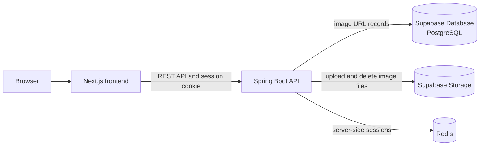

# Authentication & Cookie Session

A hands-on learning project for practicing Spring Security authentication, server-side sessions, and cookie-based API protection. It is aimed at a developer who already understands the basic flow of a Spring application and wants to build a more secure backend through implementation.

The application is a Ronaldo photo gallery. Visitors can browse the gallery; a single administrator can sign in, upload images, and delete images.

> **Implementation status (2026-11-14):** The backend currently implements CSRF-token delivery, public cursor-paginated gallery listing, admin login/current-session lookup, admin logout, opt-in admin provisioning, protected image upload, image validation, and image deletion. The frontend is not implemented in this checkout. The full Spring application context now starts against PostgreSQL and Redis Testcontainers with Flyway migration validation; this is not live proof against external Supabase services.

## Phase 1 scope

The bullets below describe the Phase 1 target. See [Implementation status](#implementation-status) and [Roadmap](#roadmap) for the current source-code status.

- Visitors can browse the public image gallery.
- The gallery loads the first 10 images and fetches additional images in pages of 10 as the visitor scrolls (infinite scrolling).
- One administrator signs in with email and password, uploads image files, and deletes images.
- The admin can log out; logout invalidates the server-side session.
- Image files are stored in the public Supabase Storage `gallery` bucket at the fixed path `images/{imageId}`. Supabase Database (PostgreSQL) stores application gallery records containing `imageId`, the business field `image_url`, and the system-managed `created_at` field; no title, caption, description, or other user-provided metadata is required.
- Redis is used for server-side session storage.
- Uploaded images must use the approved formats `.jpg`, `.jpeg`, `.png`, `.HEIC`, `.HEIF`, `.WebP`, or `.AVIF`, with a maximum file size of 15 MB.
- Server-side sessions last 10 minutes and use session rotation.
- CSRF tokens are generated by `SecureRandomCookieCsrfTokenRepository` with 32 random bytes and encoded using unpadded Base64 URL encoding.
- The public CSRF endpoint is `GET /api/v1/csrf-token`, with no request body, path variable, or query parameter.
- The CSRF endpoint stores the generated token in the `XSRF-TOKEN` cookie; it does not return the token in `data.token`. The frontend echoes the cookie value in the `X-XSRF-TOKEN` header for all state-changing requests, including login.
- Gallery pagination uses an opaque `nextCursor`: the initial request omits it, subsequent requests send it, and every request returns up to 10 images.
- API responses use a common `status`, `code`, `message`, `timestamp`, and endpoint-specific `data` envelope. Successful login and image upload return `201 Created`; successful logout and image deletion return `200 OK`.

See [PRD.md](PRD.md) for product requirements, flows, security expectations, and acceptance criteria.

## Learning goals

- Understand how requests move through a Spring Boot application.
- Practice REST API design with Java and Spring Boot.
- Learn Spring Security authentication and authorization.
- Understand server-side sessions, cookies, and login/logout behavior.
- Apply CSRF protection and safe image upload validation.
- Use AI as a learning and development assistant while reviewing and understanding generated code.

## Implementation status

Status below is based on the source tree and test run completed on 2026-11-14. It does not claim a successful live request against external PostgreSQL, Redis, or Supabase services.

| Area | Status | Current source evidence |
| --- | --- | --- |
| CSRF endpoint and cookie flow | Implemented | `CsrfController` and `SecurityConfig` expose `GET /api/v1/csrf-token`, issue `XSRF-TOKEN`, and protect state-changing requests. |
| Admin login and current-session lookup | Implemented | `AdminController`, `AdminSessionService`, `AdminUserDetailsService`, and `SecurityConfig` authenticate the admin, rotate the session ID, and use Redis-backed Spring Session. |
| Admin logout | Implemented | `AdminController` delegates `DELETE /api/v1/auth/admin/sessions` to `AdminSessionService`; `AdminSessionRepository` invalidates the Spring Session-backed Redis session and Spring Session expires the browser cookie. |
| Opt-in admin provisioning | Implemented | `AdminSeedRunner` and `AdminSeedService` create an account once and store only a BCrypt hash. |
| Image upload | Implemented | `ImageController`, `ImageUploadServiceImpl`, `SupabaseImageStorage`, and `ImageRepository` coordinate Storage-first upload and database persistence. |
| Image upload validation | Implemented | `ImageFileValidator` checks the allowlist, MIME type, magic bytes, and the 15 MB limit. |
| Image deletion | Implemented with a recovery gap | `ImageDeletionServiceImpl` deletes Storage before PostgreSQL and handles failures; a database failure after remote deletion still requires reconciliation. |
| Public image listing | Implemented | `ImageController`, `ImageListingServiceImpl`, `ImageRepository`, and focused tests implement `GET /api/v1/images` with opaque `nextCursor` keyset pagination and up to 10 items per page. |
| Frontend | Not implemented | No Next.js/TypeScript application files or frontend scripts are present in this checkout. |
| Focused listing verification | Passed | Listing service, controller, and repository tests pass in the current Maven test suite. |
| Full application-context verification | Passed | `@SpringBootTest` starts PostgreSQL and Redis Testcontainers, applies `V1__create_schemas.sql` through Flyway, completes Hibernate schema validation, and passes `ApplicationIntegrationTest` with mocked Supabase Storage. |

## Confirmed technology stack

| Area | Technology |
| --- | --- |
| Frontend | Next.js, TypeScript (planned; no frontend source in this checkout) |
| Backend | Java, Spring Boot, Spring Web MVC, Spring Security, Spring Data JPA, Bean Validation |
| Database | Supabase Database (PostgreSQL) |
| Image storage | Supabase Storage |
| Session store | Redis |
| Testing | JUnit 5, Mockito, Testcontainers, Flyway |

The verified backend toolchain uses Java `21.0.12`, Maven Wrapper `3.10.0`, and Spring Boot `4.1.2`. Exact external service configuration remains environment-specific.

## Architecture overview

The intended frontend runs separately from the backend. In the current checkout, only the Spring Boot backend is present. The backend authenticates the administrator, stores session state in Redis, reads and writes gallery records in `public.images`, and uploads/removes actual image files in the Supabase Storage `gallery` bucket.



The actual image binary is stored in Supabase Storage, not PostgreSQL. The `public.images` table stores the application gallery record with physical columns `id`, `image_url`, and system-managed `created_at`; the API exposes `id` as `imageId`. Gallery queries order records with `ORDER BY created_at DESC, id DESC` so newly uploaded images appear first. The current migration creates this supporting index:

```sql
CREATE INDEX IF NOT EXISTS idx_images_created_at
ON images (created_at);
```

The upload flow generates an `imageId`, creates the fixed Storage object path `images/{imageId}`, validates the image, uploads it to the public `gallery` bucket, obtains its URL, and inserts the `imageId`, `image_url`, and `created_at` into `public.images`. Delete requests use `imageId` to recreate the same `images/{imageId}` path, delete the file through the Supabase Storage API, and then delete the corresponding database record. Storage objects must not be deleted directly from `storage.objects` with SQL.

The gallery list request omits `nextCursor` for the first page. Each subsequent request sends the opaque cursor returned by the previous response. Responses include `limit`, `nextCursor`, and `hasNextPage` pagination metadata, with up to 10 images per request.

## Security notes

- Gallery reads are public; image management requires an authenticated administrator.
- The Supabase Storage `gallery` bucket is public for image delivery; upload and delete operations remain protected by the backend.
- Cookie-based authentication must use an explicitly configured CSRF defense for state-changing requests.
- The frontend obtains a CSRF token from the public `GET /api/v1/csrf-token` endpoint, reads it from the `XSRF-TOKEN` cookie, and sends it in the `X-XSRF-TOKEN` header for all state-changing requests, including login.
- During local development, the session cookie is `HttpOnly; SameSite=Lax` with `Secure` disabled and `Domain` omitted (host-only). The custom CSRF repository issues a frontend-readable `XSRF-TOKEN` cookie with `Path=/; SameSite=Lax`, `Secure` disabled, and `Domain` omitted; it is not `HttpOnly`. Enable the CSRF and session `Secure` flags when deploying over HTTPS.
- Validate uploaded image size and actual file content/type on the server. Accept only `.jpg`, `.jpeg`, `.png`, `.HEIC`, `.HEIF`, `.WebP`, and `.AVIF` files up to 15 MB. Do not trust only the extension or browser-supplied MIME type.
- Generate `imageId` before upload, store the file at `images/{imageId}` in the public Supabase Storage `gallery` bucket, and store the resulting `imageId`, `image_url`, and system-managed `created_at` in `public.images`.
- Use `imageId`, not `imageURL`, when requesting image deletion. Delete the Storage object through the Supabase Storage API and remove the corresponding `public.images` record.
- The initial admin account should be provisioned through a seed or migration. Store only a password hash in the database, and supply the initial password through secret configuration rather than committing it to source control.
- Server-side sessions expire after 10 minutes and use session rotation. `SecureRandomCookieCsrfTokenRepository` generates 32 random bytes and encodes them with unpadded Base64 URL encoding. Login and endpoint request-rate limiting is out of scope; the API does not impose an application-level request-rate limit.
- These are project requirements and learning goals, not a claim that the application is production-ready.

### Generated security password

The current source has a custom `SecurityConfig`, `AdminUserDetailsService`, and `PasswordEncoderConfig`; the application is intended to authenticate the provisioned admin rather than use Spring Boot's generated default user. If a generated-password message appears, inspect the active configuration and startup profile before treating it as a valid project login flow.

## Local development

This checkout contains the Spring Boot backend only. It runs on port `8080`; frontend commands and `localhost:3000` integration are still planned because no frontend package or scripts are present.

### Prerequisites

For the verified backend workflow, use Java `21.0.12`, Docker Desktop, and the repository's Maven Wrapper. Docker Desktop is required because the test suite starts PostgreSQL and Redis through Testcontainers. Node.js and frontend setup remain pending until the frontend is added to this repository.

### Run and test

Use the repository's Maven Wrapper for backend tasks. Load `.env` in the same shell before running the application or executable JAR.

## Verified backend commands

Run these commands from the repository root. The commands below were verified with Java `21.0.12`, Maven Wrapper `3.10.0`, Docker Desktop `29.8.0`, and the configured database credentials.

```bash
export JAVA_HOME="/Users/phanhaianh/Library/Java/JavaVirtualMachines/temurin-21.0.12/Contents/Home"
export PATH="$JAVA_HOME/bin:$PATH"

java -version
./mvnw -version
docker info

set -a
source .env
set +a

./mvnw clean test
./mvnw clean package
java -jar target/Authentication_CookieSession-0.0.1-SNAPSHOT.jar
```

When the commands complete successfully, `./mvnw clean test` runs the unit/integration suite and `./mvnw clean package` creates the executable JAR at `target/Authentication_CookieSession-0.0.1-SNAPSHOT.jar`. Testcontainers requires Docker; external database, Redis, and Supabase behavior still needs a live environment check.

## Configuration

`.env.example` is a committed template containing variable names and safe placeholders. Create a local `.env` file from it, keep `.env` out of source control, and load it in the same shell before running the application. Never copy real passwords, service keys, or other secrets into `.env.example` or this README.

```bash
cp .env.example .env
set -a
source .env
set +a
```

Values containing shell-sensitive characters such as `&`, `$`, `!`, `#`, spaces, or similar characters should be quoted in `.env`. `SPRING_DATASOURCE_PASSWORD` must be the PostgreSQL database password; it must not be replaced with a Supabase service-role key.

| Variable | Purpose | Current runtime status |
| --- | --- | --- |
| `SERVER_PORT` | Intended backend HTTP port | Listed in `.env.example`, but `application.properties` currently sets `server.port=8080` directly; changing this variable has no effect yet |
| `SPRING_DATASOURCE_URL` | PostgreSQL JDBC connection URL | Required and consumed by `spring.datasource.url` |
| `SPRING_DATASOURCE_USERNAME` | PostgreSQL database username | Required and consumed by `spring.datasource.username` |
| `SPRING_DATASOURCE_PASSWORD` | PostgreSQL database password | Required and consumed by `spring.datasource.password` |
| `SPRING_DATA_REDIS_HOST` | Redis host | Optional at runtime; defaults to `localhost` when absent |
| `SPRING_DATA_REDIS_PORT` | Redis port | Optional at runtime; defaults to `6379` when absent |
| `ADMIN_EMAIL` | Initial administrator email | Consumed only when `ADMIN_SEED_ENABLED=true`; never logged |
| `ADMIN_INITIAL_PASSWORD` | Initial administrator password | Consumed only when `ADMIN_SEED_ENABLED=true`; hashed with BCrypt and never stored as plaintext |
| `ADMIN_SEED_ENABLED` | Enables idempotent initial-admin provisioning | Defaults to `false`; enable only for an intentional seed run |
| `SUPABASE_URL` | Supabase project base URL used by Storage REST API | Required when upload is used; never log service credentials |
| `SUPABASE_SECRET_KEY` | Backend credential for Storage upload and cleanup | Required when upload is used; keep only in local/deployment secret configuration |
| `SUPABASE_STORAGE_BUCKET` | Public Storage bucket name | Optional; defaults to `gallery` |
| `CSRF_COOKIE_NAME` | CSRF cookie name | Optional; defaults to `XSRF-TOKEN` |
| `CSRF_HEADER_NAME` | CSRF request header name | Optional; defaults to `X-XSRF-TOKEN` |
| `CSRF_PARAMETER_NAME` | CSRF request parameter name | Optional; defaults to `_csrf` |
| `CSRF_COOKIE_PATH` | CSRF cookie path | Optional; defaults to `/` |
| `CSRF_COOKIE_SAME_SITE` | CSRF cookie SameSite attribute | Optional; defaults to `Lax` |
| `CSRF_COOKIE_DOMAIN` | Optional CSRF cookie domain | Empty by default; omit for a host-only cookie |
| `CSRF_COOKIE_SECURE` | CSRF cookie Secure flag | Defaults to `false`; set to `true` over HTTPS |
| `CSRF_TOKEN_BYTES` | Random bytes per CSRF token | Optional; defaults to `32` and cannot be below 32 |

| Setting | Status |
| --- | --- |
| Backend and frontend ports | Backend: `localhost:8080` verified; frontend: `localhost:3000` intended, frontend not yet available |
| Supabase database connection | Supabase PostgreSQL connection supplied through `SPRING_DATASOURCE_URL`, `SPRING_DATASOURCE_USERNAME`, and `SPRING_DATASOURCE_PASSWORD` |
| Supabase Storage configuration | Supplied through `SUPABASE_URL`, `SUPABASE_SECRET_KEY`, and optional `SUPABASE_STORAGE_BUCKET`; the default bucket is `gallery` |
| Redis connection | Supplied through `SPRING_DATA_REDIS_HOST` and `SPRING_DATA_REDIS_PORT`, with defaults `localhost` and `6379` |
| Initial admin email/password | Set `ADMIN_SEED_ENABLED=true` together with both admin variables for initial provisioning; the seed does not overwrite an existing account |

### Provision the initial admin

The initial admin seed is disabled by default. To create the account once, set the following values in a local, untracked `.env` file:

```dotenv
ADMIN_SEED_ENABLED=true
ADMIN_EMAIL=admin@example.com
ADMIN_INITIAL_PASSWORD=use-a-strong-local-secret
```

Load the environment and start the application. The startup seed trims and normalizes the email, hashes the password with BCrypt, and inserts the account only when that email does not already exist. It never stores or logs the plaintext password and never overwrites an existing admin account.

After the account is provisioned, set `ADMIN_SEED_ENABLED=false` and remove the initial password from the runtime environment. Password changes should be implemented as a separate authenticated flow rather than by re-running the initial seed.

## API outline

The table separates operations implemented in the current backend from requirements that remain planned.

| Operation | Access | Successful status | Current status |
| --- | --- | --- | --- |
| Get CSRF token: `GET /api/v1/csrf-token` | Public | `200 OK` | Implemented |
| List gallery images with `nextCursor` pagination | Public | `200 OK` | Implemented |
| Admin login: `POST /api/v1/auth/admin` | Administrator credentials | `201 Created` | Implemented |
| Current session: `GET /api/v1/auth/admin/sessions` | Authenticated administrator | `200 OK` | Implemented |
| Admin logout: `DELETE /api/v1/auth/admin/sessions` | Authenticated administrator + CSRF | `200 OK` | Implemented |
| Upload an image: `POST /api/v1/images` | Authenticated administrator + CSRF | `201 Created` | Implemented |
| Delete an image: `DELETE /api/v1/images/{imageId}` | Authenticated administrator + CSRF | `200 OK` | Implemented with reconciliation gap |

## Current repository

The current repository contains the Spring Boot backend. A frontend directory, package manifest, and frontend run commands have not been added yet.

## Roadmap

- [x] Finalize the API contract and image data model, including the supporting `created_at` index.
- [x] Implement public image listing with initial and subsequent page sizes of 10, ordered by newest `created_at` first.
- [x] Implement admin authentication and current-session lookup with Spring Security and Redis-backed sessions.
- [x] Implement admin logout and server-side session invalidation endpoint.
- [x] Provision the single admin account securely with an opt-in, idempotent seed.
- [x] Protect image upload with authorization and CSRF defenses.
- [x] Implement image deletion with authorization, CSRF defenses, and Storage-first/database-second handling; reconciliation after a database failure remains open.
- [x] Implement UC04 upload persistence across Supabase Storage and Supabase Database.
- [x] Add server-side upload validation and focused automated tests.
- [x] Document verified backend setup, configuration, run, test, and packaging commands.
- [x] Add application integration tests for UC00–UC06 through the real Spring context, PostgreSQL/Redis Testcontainers, and mocked Supabase Storage.
- [x] Cover UC04/UC05 edge cases for CSRF, authentication, malformed input, file boundaries, validation, missing records, repeated deletion, and Storage failures.
- [ ] Add the frontend and document its commands and integration-specific configuration.
- [ ] Reverify the implemented flows against live PostgreSQL, Redis, and Supabase services.
