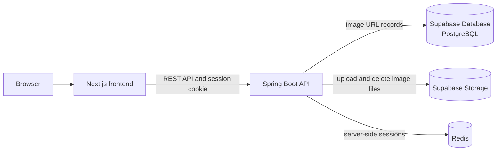

# Authentication & Cookie Session

A hands-on learning project for practicing Spring Security authentication, server-side sessions, and cookie-based API protection. It is aimed at a developer who already understands the basic flow of a Spring application and wants to build a more secure backend through implementation.

The application is a Ronaldo photo gallery. Visitors can browse the gallery; a single administrator can sign in, upload images, and delete images.

> **Project status:** Confirmed Phase 1 requirements are documented here. API-contract details, implementation status, versions, commands, environment variables, and other configuration values remain to be finalized or verified. Do not treat documented requirements or setup instructions as proof of implementation.

## Phase 1 scope

- Visitors can browse the public image gallery.
- The gallery loads the first 10 images and fetches additional images in pages of 20 as the visitor scrolls (infinite scrolling).
- One administrator signs in with email and password, uploads image files, and deletes images.
- The admin can log out; logout invalidates the server-side session.
- Image files are stored in Supabase Storage. Supabase Database (PostgreSQL) stores image records containing the image URL only; no title or description is required.
- Redis is used for server-side session storage.
- Uploaded images must use the approved formats `.jpg`, `.jpeg`, `.png`, `.HEIC`, `.HEIF`, `.WebP`, or `.AVIF`, with a maximum file size of 15 MB.
- Server-side sessions last 10 minutes and use session rotation.
- CSRF tokens are generated with `SecureRandom` and encoded using Base64 URL encoding.
- Login requests are limited to 3 requests per second.

See [PRD.md](PRD.md) for product requirements, flows, security expectations, and acceptance criteria.

## Learning goals

- Understand how requests move through a Spring Boot application.
- Practice REST API design with Java and Spring Boot.
- Learn Spring Security authentication and authorization.
- Understand server-side sessions, cookies, and login/logout behavior.
- Apply CSRF protection and safe image upload validation.
- Use AI as a learning and development assistant while reviewing and understanding generated code.

## Confirmed technology stack

| Area | Technology |
| --- | --- |
| Frontend | Next.js, TypeScript |
| Backend | Java, Spring Boot, Spring Web MVC, Spring Security, Spring Data JPA, Bean Validation |
| Database | Supabase Database (PostgreSQL) |
| Image storage | Supabase Storage |
| Session store | Redis |
| Testing | JUnit 5, Mockito, Testcontainers (planned) |

Versions and exact service configuration have not yet been finalized.

## Architecture overview

The frontend runs separately from the backend in the same Git repository. The browser communicates with the Spring Boot REST API. The backend authenticates the administrator, stores session state in Redis, reads and writes image URL records in Supabase Database, and uploads/removes image files in Supabase Storage.



## Security notes

- Gallery reads are public; image management requires an authenticated administrator.
- Cookie-based authentication must use an explicitly configured CSRF defense for state-changing requests.
- Configure appropriate cookie attributes, including `HttpOnly`, `Secure` for HTTPS deployments, and a suitable `SameSite` policy.
- Validate uploaded image size and actual file content/type on the server. Accept only `.jpg`, `.jpeg`, `.png`, `.HEIC`, `.HEIF`, `.WebP`, and `.AVIF` files up to 15 MB. Do not trust only the extension or browser-supplied MIME type.
- The initial admin account should be provisioned through a seed or migration. Store only a password hash in the database, and supply the initial password through secret configuration rather than committing it to source control.
- Server-side sessions expire after 10 minutes and use session rotation. Generate CSRF tokens with `SecureRandom` and encode them using Base64 URL encoding. Limit login requests to 3 requests per second.
- These are project requirements and learning goals, not a claim that the application is production-ready.

## Local development

This repository is intended to contain both the Spring Boot backend and the Next.js/TypeScript frontend. The frontend runs at `localhost:3000`; the frontend directory and local service setup still need to be documented once finalized.

### Prerequisites

Confirm and document the required versions and setup instructions for Java, Node.js, the package manager, Supabase, and Redis. If a local Supabase environment is used, document its setup as well.

### Run and test

Use the repository's Maven wrapper for backend tasks. Frontend commands and required services should be verified and documented later, after implementation is completed.

```bash
# TODO: Document the required local Supabase and Redis setup.
# TODO: Add verified backend run and test commands.
# TODO: Add the frontend location and verified run commands later.
```

## Configuration

Environment variable names and safe example values are intentionally not documented yet. Document them later after configuration is implemented, and keep credentials and secrets outside source control.

| Setting | Status |
| --- | --- |
| Backend and frontend ports | Frontend: `localhost:3000`; backend: planned local address `localhost:8080`, verify during implementation |
| Supabase database connection | To be documented |
| Supabase Storage configuration | To be documented |
| Redis connection | To be documented |
| Initial admin email/password | Supply securely outside source control; exact provisioning configuration to be documented |

## API outline

These are confirmed operations, but not confirmed route names or implemented endpoints. Define request/response schemas and errors in the API contract later; those API-contract details remain deferred.

| Operation | Access |
| --- | --- |
| List gallery images with pagination | Public |
| Admin login | Administrator credentials |
| Admin logout | Authenticated administrator |
| Upload an image | Authenticated administrator |
| Delete an image | Authenticated administrator |

## Current repository

This repository is intended to contain both the Spring Boot backend and the Next.js/TypeScript frontend in the same Git repository. Document the frontend directory and verified commands when the frontend structure is finalized.

## Roadmap

- [ ] Finalize the API contract and image data model.
- [ ] Implement public image listing with initial page size 10 and subsequent page size 20.
- [ ] Implement admin authentication with Spring Security and Redis-backed sessions.
- [ ] Provision the single admin account securely.
- [ ] Protect upload and delete operations with authorization and CSRF defenses.
- [ ] Integrate Supabase Storage and Supabase Database.
- [ ] Add server-side upload validation and automated tests.
- [ ] Document verified setup, configuration, run, and test commands.
