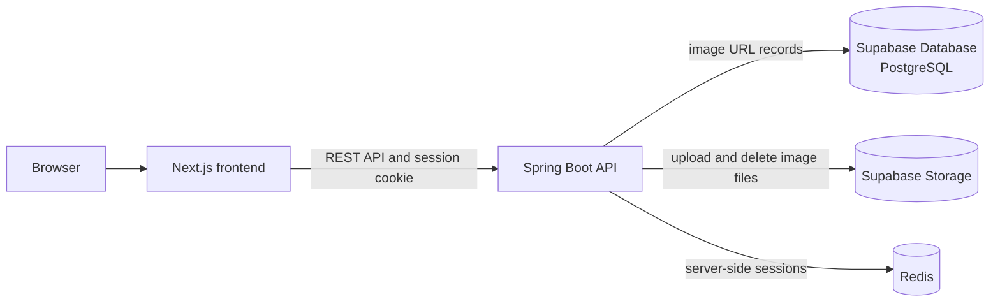

# Authentication & Cookie Session

A hands-on learning project for practicing Spring Security authentication, server-side sessions, and cookie-based API protection. It is aimed at a developer who already understands the basic flow of a Spring application and wants to build a more secure backend through implementation.

The application is a Ronaldo photo gallery. Visitors can browse the gallery; a single administrator can sign in, upload images, and delete images.

> **Project status:** Confirmed Phase 1 requirements are documented here. API-contract details and some integrations remain to be finalized, while the backend toolchain, tests, packaging, and executable JAR workflow below have been verified. Do not treat documented requirements as proof that every feature is implemented.

## Phase 1 scope

- Visitors can browse the public image gallery.
- The gallery loads the first 10 images and fetches additional images in pages of 20 as the visitor scrolls (infinite scrolling).
- One administrator signs in with email and password, uploads image files, and deletes images.
- The admin can log out; logout invalidates the server-side session.
- Image files are stored in Supabase Storage. Supabase Database (PostgreSQL) stores image records containing the image URL only; no title or description is required.
- Redis is used for server-side session storage.
- Uploaded images must use the approved formats `.jpg`, `.jpeg`, `.png`, `.HEIC`, `.HEIF`, `.WebP`, or `.AVIF`, with a maximum file size of 15 MB.
- Server-side sessions last 10 minutes and use session rotation.
- CSRF tokens are generated with `SecureRandom` and encoded using Base64 URL encoding.
- Login requests are limited to 3 requests per second.

See [PRD.md](PRD.md) for product requirements, flows, security expectations, and acceptance criteria.

## Learning goals

- Understand how requests move through a Spring Boot application.
- Practice REST API design with Java and Spring Boot.
- Learn Spring Security authentication and authorization.
- Understand server-side sessions, cookies, and login/logout behavior.
- Apply CSRF protection and safe image upload validation.
- Use AI as a learning and development assistant while reviewing and understanding generated code.

## Confirmed technology stack

| Area | Technology |
| --- | --- |
| Frontend | Next.js, TypeScript |
| Backend | Java, Spring Boot, Spring Web MVC, Spring Security, Spring Data JPA, Bean Validation |
| Database | Supabase Database (PostgreSQL) |
| Image storage | Supabase Storage |
| Session store | Redis |
| Testing | JUnit 5, Mockito, Testcontainers |

The verified backend toolchain uses Java `21.0.12`, Maven Wrapper `3.10.0`, and Spring Boot `4.1.2`. Exact external service configuration remains environment-specific.

## Architecture overview

The frontend runs separately from the backend in the same Git repository. The browser communicates with the Spring Boot REST API. The backend authenticates the administrator, stores session state in Redis, reads and writes image URL records in Supabase Database, and uploads/removes image files in Supabase Storage.



## Security notes

- Gallery reads are public; image management requires an authenticated administrator.
- Cookie-based authentication must use an explicitly configured CSRF defense for state-changing requests.
- Configure appropriate cookie attributes, including `HttpOnly`, `Secure` for HTTPS deployments, and a suitable `SameSite` policy.
- Validate uploaded image size and actual file content/type on the server. Accept only `.jpg`, `.jpeg`, `.png`, `.HEIC`, `.HEIF`, `.WebP`, and `.AVIF` files up to 15 MB. Do not trust only the extension or browser-supplied MIME type.
- The initial admin account should be provisioned through a seed or migration. Store only a password hash in the database, and supply the initial password through secret configuration rather than committing it to source control.
- Server-side sessions expire after 10 minutes and use session rotation. Generate CSRF tokens with `SecureRandom` and encode them using Base64 URL encoding. Limit login requests to 3 requests per second.
- These are project requirements and learning goals, not a claim that the application is production-ready.

### Generated security password

When the Spring Security starter is on the classpath and a custom security configuration has not yet replaced Spring Boot's default security configuration, Spring Boot creates a default development user and generates a random password at startup. The password is printed in the application log with a message such as `Using generated security password`.

This generated password is only for the temporary default development authentication. It is not the `ADMIN_INITIAL_PASSWORD`, the PostgreSQL password, or a Supabase credential. It changes between application starts, must not be committed or used as a production credential, and should disappear once the project's custom administrator authentication is implemented.

## Local development

This repository is intended to contain both the Spring Boot backend and the Next.js/TypeScript frontend. The verified backend runs on port `8080`; the frontend is intended to run at `localhost:3000`, but frontend commands are not documented until its package and scripts are available.

### Prerequisites

For the verified backend workflow, use Java `21.0.12`, Docker Desktop, and the repository's Maven Wrapper. Docker Desktop is required because the test suite starts PostgreSQL and Redis through Testcontainers. Node.js and frontend setup remain pending until the frontend is added to this repository.

### Run and test

Use the repository's Maven Wrapper for backend tasks. Load `.env` in the same shell before running the application or executable JAR.

## Verified backend commands

Run these commands from the repository root. The commands below were verified with Java `21.0.12`, Maven Wrapper `3.10.0`, Docker Desktop `29.8.0`, and the configured database credentials.

```bash
export JAVA_HOME="/Users/phanhaianh/Library/Java/JavaVirtualMachines/temurin-21.0.12/Contents/Home"
export PATH="$JAVA_HOME/bin:$PATH"

java -version
./mvnw -version
docker info

set -a
source .env
set +a

./mvnw clean test
./mvnw clean package
java -jar target/Authentication_CookieSession-0.0.1-SNAPSHOT.jar
```

`./mvnw clean test` completed with 1 test, 0 failures, and 0 errors. `./mvnw clean package` created the executable JAR at `target/Authentication_CookieSession-0.0.1-SNAPSHOT.jar`. Stop the running application with `Ctrl+C`.

## Configuration

`.env.example` is a committed template containing variable names and safe placeholders. Create a local `.env` file from it, keep `.env` out of source control, and load it in the same shell before running the application. Never copy real passwords, service keys, or other secrets into `.env.example` or this README.

```bash
cp .env.example .env
set -a
source .env
set +a
```

Values containing shell-sensitive characters such as `&`, `$`, `!`, `#`, spaces, or similar characters should be quoted in `.env`. `SPRING_DATASOURCE_PASSWORD` must be the PostgreSQL database password; it must not be replaced with a Supabase service-role key.

| Variable | Purpose | Current runtime status |
| --- | --- | --- |
| `SERVER_PORT` | Intended backend HTTP port | Listed in `.env.example`, but `application.properties` currently sets `server.port=8080` directly; changing this variable has no effect yet |
| `SPRING_DATASOURCE_URL` | PostgreSQL JDBC connection URL | Required and consumed by `spring.datasource.url` |
| `SPRING_DATASOURCE_USERNAME` | PostgreSQL database username | Required and consumed by `spring.datasource.username` |
| `SPRING_DATASOURCE_PASSWORD` | PostgreSQL database password | Required and consumed by `spring.datasource.password` |
| `SPRING_DATA_REDIS_HOST` | Redis host | Optional at runtime; defaults to `localhost` when absent |
| `SPRING_DATA_REDIS_PORT` | Redis port | Optional at runtime; defaults to `6379` when absent |
| `ADMIN_EMAIL` | Initial administrator email | Listed in `.env.example`, but not currently consumed by `application.properties` |
| `ADMIN_INITIAL_PASSWORD` | Initial administrator password | Listed in `.env.example`, but not currently consumed by `application.properties` |

| Setting | Status |
| --- | --- |
| Backend and frontend ports | Backend: `localhost:8080` verified; frontend: `localhost:3000` intended, frontend not yet available |
| Supabase database connection | Supabase PostgreSQL connection supplied through `SPRING_DATASOURCE_URL`, `SPRING_DATASOURCE_USERNAME`, and `SPRING_DATASOURCE_PASSWORD` |
| Supabase Storage configuration | No Supabase Storage-specific variable is currently defined in `.env.example`; document it when the integration configuration is implemented |
| Redis connection | Supplied through `SPRING_DATA_REDIS_HOST` and `SPRING_DATA_REDIS_PORT`, with defaults `localhost` and `6379` |
| Initial admin email/password | `ADMIN_EMAIL` and `ADMIN_INITIAL_PASSWORD` are listed in `.env.example` but are not currently consumed by `application.properties` |

## API outline

These are confirmed operations, but not confirmed route names or implemented endpoints. Define request/response schemas and errors in the API contract later; those API-contract details remain deferred.

| Operation | Access |
| --- | --- |
| List gallery images with pagination | Public |
| Admin login | Administrator credentials |
| Admin logout | Authenticated administrator |
| Upload an image | Authenticated administrator |
| Delete an image | Authenticated administrator |

## Current repository

This repository is intended to contain both the Spring Boot backend and the Next.js/TypeScript frontend in the same Git repository. Document the frontend directory and verified commands when the frontend structure is finalized.

## Roadmap

- [ ] Finalize the API contract and image data model.
- [ ] Implement public image listing with initial page size 10 and subsequent page size 20.
- [ ] Implement admin authentication with Spring Security and Redis-backed sessions.
- [ ] Provision the single admin account securely.
- [ ] Protect upload and delete operations with authorization and CSRF defenses.
- [ ] Integrate Supabase Storage and Supabase Database.
- [ ] Add server-side upload validation and automated tests.
- [x] Document verified backend setup, configuration, run, test, and packaging commands.
- [ ] Document frontend commands and remaining integration-specific configuration after implementation.
