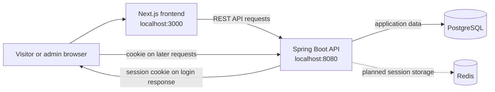

# ⚽ Authentication & Cookie Session

> **A small Ronaldo photo gallery and a hands-on journey into secure backend development.**

Authentication & Cookie Session is a learning project for building a photo website where visitors can browse Cristiano Ronaldo photos and an admin can manage the gallery. The project is designed to make the fundamentals of REST APIs, Spring Boot request flow, authentication, sessions, cookies, and authorization easier to understand through practical implementation.

> [!NOTE]
> This repository currently describes the project plan. Implementation details, routes, and run commands should be updated as the application takes shape.

## 🎯 Learning goals

- Understand how an HTTP request travels through a backend application.
- Design and implement REST APIs with Java and Spring Boot.
- Learn Spring Security fundamentals and common configuration patterns.
- Understand server-side sessions, browser cookies, and login behavior.
- Practice building a backend that is secure, maintainable, and efficient.
- Use AI as a learning and development assistant while checking and understanding the code it produces.

## ✨ Planned features

| Role | Planned abilities |
| --- | --- |
| Visitor | Browse the public Ronaldo photo gallery without signing in. |
| Admin | Sign in, add photos, and delete photos. |

**Photo storage:** To be defined. The database choice for photo metadata and the storage location for image files have not yet been specified.

## 🧰 Technology stack

| Area | Technologies |
| --- | --- |
| Frontend | Next.js, TypeScript |
| Backend | Java, Spring Boot, Spring Security, Spring Data JPA, Bean Validation |
| Testing | JUnit 5, Mockito, Testcontainers |
| Database | PostgreSQL |
| Session store | Redis (planned; exact session configuration to be defined) |

## 🏗️ Architecture and request flow

The frontend runs separately from the backend. The browser communicates with the Spring Boot REST API. PostgreSQL is planned for persistent application data; Redis is listed for session storage, but its exact use remains to be implemented and documented.



Typical admin flow: submit login credentials → backend authenticates the admin → backend creates a server-side session and returns a session cookie → browser includes that cookie in subsequent requests → Spring Security checks authentication and authorization before allowing photo-management actions.

## 🔐 Authentication, sessions, and cookies

The planned admin login uses a **server-side session**. The browser stores a session identifier in a cookie; the session data itself is held by the backend’s session mechanism. The browser sends the cookie with later requests so the backend can associate them with the signed-in admin.

A session cookie does not automatically mean “remember me.” A browser may discard a session cookie when its session ends, so users should not be promised that closing and reopening the browser preserves their login. Persistent login requires an explicitly designed and secured mechanism with its own lifetime and revocation behavior.

Cookie settings, session expiration, credential handling, and the Redis integration are **to be defined and verified during implementation**.

## 🛡️ Authorization and security

Planned access rules:

- Gallery read operations are public.
- Login is available to unauthenticated admins.
- Adding or deleting photos requires an authenticated admin.

Because browsers automatically attach cookies to requests, cookie-based authentication requires careful **CSRF (Cross-Site Request Forgery) protection** for state-changing operations. The implementation should configure and document its CSRF strategy rather than disabling protection without justification. Also define appropriate cookie attributes (such as `HttpOnly`, `Secure` in HTTPS deployments, and `SameSite`), validate inputs, and avoid committing secrets.

These are learning goals, not a claim that the project is production-ready.

## 🚀 Local development

### Local addresses

| Application | Address |
| --- | --- |
| Frontend | `http://localhost:3000` |
| Backend | `http://localhost:8080` |

The backend is intended to run locally on the developer’s machine.

### Prerequisites

Install the required Java version, Node.js, package manager, PostgreSQL, and Redis versions once they are selected. Exact versions and installation steps are **TODO**.

### Run the applications

Repository layout and build tooling are not available yet, so use these as placeholders and replace them with verified commands:

```bash
# TODO: Start PostgreSQL and Redis using the chosen local setup.

# TODO: Start the Spring Boot backend from its actual project directory.

# TODO: Start the Next.js frontend from its actual project directory.
```

## ⚙️ Configuration

Environment variable names and configuration files have not been defined. Document them here once chosen. Do not place real passwords, session secrets, or other credentials in the repository.

| Setting | Purpose | Name / value |
| --- | --- | --- |
| Backend port | Spring Boot API | `8080` (planned local address) |
| Frontend port | Next.js app | `3000` (planned local address) |
| PostgreSQL connection | Persistent data | TODO |
| Redis connection | Session storage | TODO |
| Admin credentials | Development login | TODO; provide securely outside source control |

## 🧪 Testing

Planned test tools are JUnit 5, Mockito, and Testcontainers. Testcontainers can run integration tests against disposable service containers; exact test scope and Docker requirements are to be documented with the implementation.

```bash
# TODO: Add the verified backend test command (Maven or Gradle).
# TODO: Add the verified frontend test or check command.
```

Test cases should cover public gallery access, successful and failed login, session behavior, unauthorized and forbidden admin actions, validation errors, and CSRF behavior.

## 📡 API outline

These are suggested operations, not implemented or confirmed endpoint paths. Define the route names, request/response formats, and error responses in the API contract before treating them as final.

| Operation | Access | Status |
| --- | --- | --- |
| List photos | Public | Planned; route to be defined |
| Get photo details | Public | Optional; route to be defined |
| Admin login | Admin credentials | Planned; route to be defined |
| Admin logout | Authenticated admin | Planned; route to be defined |
| Add a photo | Authenticated admin | Planned; route to be defined |
| Delete a photo | Authenticated admin | Planned; route to be defined |

## 🗂️ Project structure

Not documented yet. Add the actual frontend and backend directory trees after their repositories or folders are created.

## 🗺️ Roadmap

- [ ] Create the frontend and Spring Boot project structure.
- [ ] Define the API contract and photo data model.
- [ ] Build public gallery read operations.
- [ ] Add admin authentication with Spring Security and server-side sessions.
- [ ] Configure Redis for sessions if it fits the implementation.
- [ ] Protect photo-management operations with authorization and CSRF defenses.
- [ ] Add validation and automated unit and integration tests.
- [ ] Document verified setup, configuration, and run commands.

---

Made for learning, one request and one session at a time. 🔐
