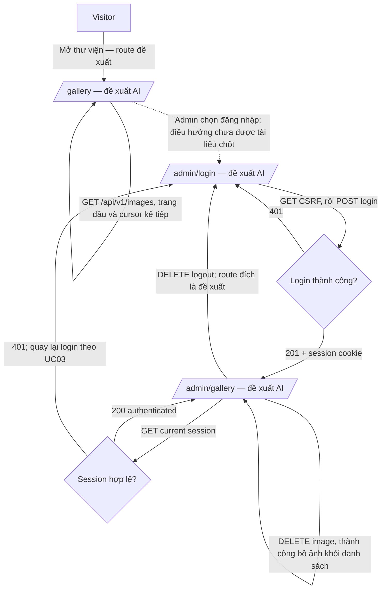

# README UI & Workflow

## 1. Tổng quan

Authentication & Cookie Session là dự án học tập về xác thực và session cookie, với website thư viện ảnh Ronaldo. Visitor xem thư viện công khai; Admin đăng nhập, tải ảnh lên, xóa ảnh và đăng xuất.

Đã phân tích `README.md`, `PRD.md`, `api_contract.md` và `use_case.md`. README cho biết backend đã có các API cần thiết nhưng frontend chưa được triển khai; Next.js/TypeScript là stack dự kiến. Các tài liệu nêu mục tiêu và hành vi sản phẩm nhưng chưa chốt frontend route hay bố cục. Vì vậy:

Các câu mang tính bắt buộc trong tài liệu được xem là yêu cầu/hành vi của sản phẩm để tổng hợp, không phải chỉ dẫn mở rộng nhiệm vụ này sang triển khai frontend hoặc thay đổi API.

- **Đã xác nhận** nghĩa là mục tiêu/hành vi được tài liệu nêu rõ.
- **Đề xuất AI** nghĩa là cách chia page, tên page hoặc route do file này đề xuất dựa trên các mục tiêu đó; đây không phải yêu cầu đã có trong tài liệu.
- Các route bên dưới là route frontend, tách biệt với endpoint backend `/api/v1/...`.

## 2. Pages và frontend routes

| Tên page | Frontend route | Trạng thái | Mục đích | Actor/điều kiện truy cập | Căn cứ |
| --- | --- | --- | --- | --- | --- |
| Thư viện ảnh công khai | `/gallery` | Page: đã xác nhận; route: **Đề xuất AI** | Duyệt các ảnh Ronaldo theo thứ tự mới nhất trước, tải thêm khi cuộn. | Visitor; không cần đăng nhập. | PRD §3, §5.1, FR-01–03; Use Case UC01. Tài liệu gọi là “gallery page” nhưng không có URL. |
| Đăng nhập Admin | `/admin/login` | Page: đã xác nhận; route: **Đề xuất AI** | Nhập email và mật khẩu để tạo session quản trị. | Admin chưa có session hợp lệ. | PRD §3, §5.2, FR-04–05; Use Case UC02 gọi rõ “login form” nhưng không có URL. |
| Quản lý thư viện ảnh | `/admin/gallery` | Page và route: **Đề xuất AI** | Admin xem thư viện và thực hiện các workflow tải ảnh lên, xem preview, xóa ảnh, đăng xuất. | Admin đã xác thực; yêu cầu kiểm tra session khi vào khu vực quản trị. | PRD §3, §5.3–5.5, FR-06–10; Use Case UC03–UC06. Đây là đề xuất gộp thao tác quản lý ảnh vào một đích sử dụng; tài liệu chưa quyết định có page quản trị riêng hay không. |

Route đề xuất dùng chữ thường và kebab-case. Không tìm thấy source frontend hoặc route convention hiện hữu trong checkout; tên route có thể cần đổi khi bắt đầu triển khai frontend.

## 3. Chi tiết từng page

### Thư viện ảnh công khai — `/gallery` *(Page đã xác nhận; route đề xuất AI)*

- **Mục đích và căn cứ:** Visitor xem ảnh mà không cần đăng nhập (PRD FR-01–03; Use Case UC01).
- **Sections/UI:**
  - **Đã xác nhận:** vùng hiển thị ảnh; giao diện tải thêm khi cuộn; trạng thái thư viện trống và trạng thái tải/lỗi tổng quát (Use Case UC01).
  - **Đề xuất AI:** danh sách/grid ảnh. Tài liệu không quy định cách trình bày hình ảnh.
- **Actions/workflows:**

| Section/control | Trigger | Các bước/kết quả | Điều hướng | API | UI state đã xác nhận |
| --- | --- | --- | --- | --- | --- |
| Vùng thư viện *(vị trí control là đề xuất)* | Mở page | Tải trang đầu, tối đa 10 ảnh; sắp xếp `created_at DESC, id DESC`. | Không có route nguồn; `/gallery` là đề xuất. | `GET /api/v1/images` không gửi `nextCursor`. | Hiển thị ảnh; rỗng thì hiển thị trạng thái thư viện trống; lỗi thì hiển thị lỗi/tải chung. |
| Vùng thư viện / cuộn trang *(vị trí control là đề xuất)* | Có thêm kết quả và Visitor cuộn | Gửi `nextCursor` opaque của response trước; mỗi request tối đa 10 ảnh; dừng khi hết dữ liệu. | Không đổi route. | `GET /api/v1/images?nextCursor=...` — query `nextCursor` theo contract. | Hiển thị ảnh theo thứ tự mới nhất trước; hết dữ liệu trả `items: []`, `nextCursor: null`. |

- **Dữ liệu hiển thị:** `data.items[]` có `imageId`, `imageURL`; `data.pagination` có `limit`, `nextCursor`, `hasNextPage`. `created_at` dùng để sắp xếp nội bộ, không bắt buộc xuất hiện trong image item (API Contract).

### Đăng nhập Admin — `/admin/login` *(Page đã xác nhận; route đề xuất AI)*

- **Mục đích và căn cứ:** Admin gửi email và mật khẩu để xác thực và tạo server-side session (PRD §5.2; Use Case UC02).
- **Sections/UI:**
  - **Đã xác nhận:** login form với email và password.
  - **Đề xuất AI:** nút submit và khu vực hiển thị lỗi xác thực/validation; văn bản và cách trình bày chưa được tài liệu quy định.
- **Actions/workflows:**

| Section/control | Trigger | Các bước/kết quả | Điều hướng | API | UI state đã xác nhận |
| --- | --- | --- | --- | --- | --- |
| Login form | Admin submit email/password | Lấy CSRF token; gửi credentials và CSRF cookie/header; thành công thì browser nhận session cookie. | Sau thành công, chuyển đến `/admin/gallery` là **đề xuất AI**; tài liệu không nêu đích đến sau đăng nhập. | `GET /api/v1/csrf-token`, sau đó `POST /api/v1/auth/admin`. | Thành công: `authenticated: true` và session cookie; sai credentials: `401`, không tạo session. UI thông báo lỗi cụ thể chưa được định nghĩa. |

- **Dữ liệu hiển thị:** Không có dữ liệu gallery được yêu cầu trên page này. Request dùng `email`, `password`; response thành công có `data.authenticated`.

### Quản lý thư viện ảnh — `/admin/gallery` *(Đề xuất AI)*

- **Mục đích và căn cứ:** Tạo một đích quản trị cho admin đã xác thực để thêm/xóa ảnh. Đây là cách nhóm các UC04–UC06 liên quan đến quản lý gallery; tài liệu xác nhận các hành động nhưng không chỉ định page hoặc vị trí control.
- **Sections/UI:**
  - **Đã xác nhận:** cần chọn ảnh và xem preview tạm thời trước khi submit; cần chọn ảnh và xác nhận trước khi xóa; sau upload/xóa thành công thư viện được cập nhật.
  - **Đề xuất AI:** dùng danh sách ảnh làm vùng quản lý, đặt workflow upload cạnh danh sách và thao tác xóa theo từng ảnh. Không có căn cứ cho bố cục, tên control hoặc hình thức xác nhận cụ thể.
- **Actions/workflows:**

| Section/control | Trigger | Các bước/kết quả | Điều hướng | API | UI state đã xác nhận |
| --- | --- | --- | --- | --- | --- |
| Khu vực quản trị *(vị trí là đề xuất)* | Vào khu vực quản trị / khôi phục session | Kiểm tra session hiện tại; session hợp lệ cho phép truy cập controls admin. | Điều hướng tới `/admin/login` khi `401` được UC03 nêu; route cụ thể là đề xuất. | `GET /api/v1/auth/admin/sessions`. | `200` authenticated thì hiển thị trạng thái admin; `401` thì trở lại trạng thái đăng nhập. |
| Chọn ảnh và preview *(preview được xác nhận; control placement là đề xuất)* | Admin chọn file | Hiển thị preview local tạm thời; preview không được backend lưu. File cho phép `.jpg`, `.jpeg`, `.png`, `.HEIC`, `.HEIF`, `.WebP`, `.AVIF`, tối đa 15 MB. | Không đổi route. | Chưa gọi API trong bước preview. | Preview tạm thời được xác nhận. Validation/UI error phía client chưa được mô tả. |
| Submit ảnh *(vị trí control là đề xuất)* | Admin gửi ảnh đã chọn | Gửi multipart `file`; backend kiểm tra quyền/CSRF và nội dung, upload Storage tại `images/{imageId}`, lưu record; sau thành công làm mới/thêm ảnh lên đầu thư viện. | Giữ `/admin/gallery` là đề xuất; đồng bộ thư viện công khai là workflow sản phẩm đã xác nhận, route khách là đề xuất. | `POST /api/v1/images`. | Thành công ảnh xuất hiện trước ảnh cũ; lỗi được định nghĩa bằng API status, phản ứng UI cụ thể chưa được nêu. |
| Ảnh trong danh sách và bước xác nhận *(vị trí control là đề xuất)* | Admin chọn ảnh và xác nhận xóa | Backend xóa Storage object rồi record; sau thành công frontend loại ảnh khỏi thư viện đang hiển thị. | Không đổi route. | `DELETE /api/v1/images/{imageId}`. | Ảnh biến mất khỏi gallery sau thành công. Dialog/wording xác nhận chưa được định nghĩa. |
| Control đăng xuất *(vị trí là đề xuất)* | Admin yêu cầu đăng xuất | Vô hiệu hóa session Redis và hết hạn session cookie. | Chuyển tới `/admin/login` sau logout là **đề xuất AI**; tài liệu chỉ xác nhận UI thành unauthenticated. | `DELETE /api/v1/auth/admin/sessions`. | UI chuyển sang unauthenticated; request bảo vệ sau đó bị từ chối. |

- **Dữ liệu hiển thị:** Danh sách có thể dùng `imageId`, `imageURL` từ API; không có title/caption/description. Các trường hiển thị quản trị khác chưa được tài liệu xác nhận.

## 4. Workflows cấp ứng dụng hoặc chưa gắn page

### CSRF cho request thay đổi trạng thái

- **Trigger:** trước login và các request thay đổi trạng thái được bảo vệ.
- **Xử lý:** gọi `GET /api/v1/csrf-token`; đọc cookie `XSRF-TOKEN`; gửi giá trị đó ở `X-XSRF-TOKEN`. Token không nằm trong `data.token`.
- **Kết quả API:** `200 OK`; lỗi tạo token `500 Internal Server Error`.
- **UI state/navigation:** không có UI state hoặc page placement được xác nhận; đây là workflow nền dùng chung.

### Kiểm tra session Admin

- **Trigger:** frontend cần xác định session hiện tại trước khi hiển thị quyền admin (thời điểm gọi chưa chốt).
- **Xử lý:** gọi `GET /api/v1/auth/admin/sessions` với browser session cookie.
- **Nhánh:** `200 OK` với `authenticated: true` cho biết session hợp lệ; `401 Unauthorized` nếu cookie thiếu/sai/hết hạn; `500 Internal Server Error` nếu lỗi kiểm tra.
- **UI/navigation:** UC03 nói hiển thị admin state và cho phép admin controls khi thành công; với `401`, frontend quay về trang login. Tên route login `/admin/login` là đề xuất AI. API status không đồng nghĩa với thông báo UI.

## 5. Navigation và luồng chính

Route/page trong sơ đồ là **đề xuất AI**, trừ khi nhãn ghi rõ tài liệu xác nhận page concept. Tài liệu không xác nhận path frontend hoặc hầu hết các chuyển trang.

## 6. Bản đồ UI ↔ API

| Page/section/control | Trigger/action | Method + endpoint | Request | API result (HTTP status/response) | UI update/state được xác nhận |
| --- | --- | --- | --- | --- | --- |
| Workflow nền, chưa gắn page | Lấy CSRF | `GET /api/v1/csrf-token` | Không body, path variable hoặc query; `Accept: application/json`. | `200 OK`; đặt cookie `XSRF-TOKEN`, không trả `data.token`; lỗi `500`. | Frontend đọc cookie và gửi giá trị trong `X-XSRF-TOKEN` cho request thay đổi trạng thái. |
| Thư viện ảnh (`/gallery` route đề xuất) | Tải trang đầu/kế tiếp khi cuộn | `GET /api/v1/images` | Request đầu không có `nextCursor`; request sau gửi cursor opaque. Không gửi `limit`. | `200 OK`; `data.items[]` có `imageId`, `imageURL`; `data.pagination` có `limit`, `nextCursor`, `hasNextPage`. Tối đa 10 item; lỗi `500`. | Hiển thị ảnh theo thứ tự mới nhất trước; empty/error state chung theo UC01; tải tiếp khi cuộn. |
| Login form (`/admin/login` route đề xuất) | Đăng nhập | `POST /api/v1/auth/admin` | JSON `email`, `password`; cookie `XSRF-TOKEN` và header `X-XSRF-TOKEN`. | `201 Created`, `data.authenticated: true`, session cookie; lỗi `400`, `401`, `403`, `500`. | Session authenticated trên thành công; thông báo lỗi cụ thể chưa xác định. |
| Workflow session, placement chưa chốt | Kiểm tra session admin | `GET /api/v1/auth/admin/sessions` | Session cookie; GET không cần CSRF header. | `200 OK`, `data.authenticated: true`; `401` session thiếu/sai/hết hạn; `500` lỗi. | Thành công cho phép admin controls; `401` trở về trang login theo UC03. |
| Chọn ảnh/preview trên page quản trị đề xuất | Preview ảnh trước submit | Chưa gọi API | Chưa có request. | Không áp dụng. | Preview local tạm thời; UI validation phía client chưa rõ. |
| Upload trên `/admin/gallery` (page đề xuất) | Submit file | `POST /api/v1/images` | `multipart/form-data`, field `file`; session cookie, `X-XSRF-TOKEN`. | `201 Created`, `data.imageId`, `data.imageURL`; lỗi `400`, `401`, `403`, `413`, `415`, `500`. | Sau thành công thêm/làm mới ảnh lên đầu gallery; các phản ứng UI lỗi chưa được chốt. |
| Xóa ảnh trên `/admin/gallery` (page/control placement đề xuất) | Xác nhận xóa ảnh | `DELETE /api/v1/images/{imageId}` | Path UUID `imageId`; session cookie, `X-XSRF-TOKEN`; không body. | `200 OK`, `data.deleted: true`, `data.imageId`; lỗi `401`, `403`, `404`, `500`. | Bỏ ảnh khỏi gallery sau thành công. |
| Đăng xuất trên `/admin/gallery` (page/control placement đề xuất) | Logout | `DELETE /api/v1/auth/admin/sessions` | Session cookie, `X-XSRF-TOKEN`; không body. | `200 OK`, `data.authenticated: false`; lỗi `401`, `500`; session bị vô hiệu hóa và cookie hết hạn. | UI unauthenticated; route sau logout chưa được tài liệu chốt. |

## Nguồn căn cứ

- `README.md`: mục tiêu dự án, actor, stack dự kiến, implementation status và xác nhận frontend chưa có.
- `PRD.md`: §3–§6 về role, user flows và functional requirements; §10 về frontend chưa triển khai.
- `api_contract.md`: chuẩn method, endpoint, request/response field và HTTP status.
- `use_case.md`: UC00–UC06 về trigger, nhánh và các cập nhật UI được mô tả.
